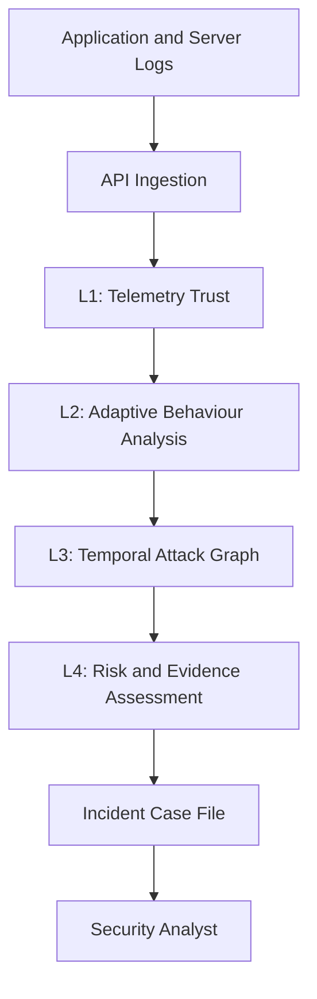

# SENTRA
### Security Telemetry Analysis & Evidence-Aware Threat Detection

> **Validate the telemetry. Connect the events. Understand the evidence.**

SENTRA is a cybersecurity prototype designed to analyze security logs, identify suspicious behavioural changes, correlate potential attack sequences, and generate explainable incident assessments.

Unlike a traditional alert-only workflow, SENTRA combines telemetry validation, adaptive detection, temporal correlation, and evidence-aware risk analysis in a single pipeline.

## 🚨 The Problem

Security systems generate large volumes of logs. Individual events may appear harmless while their combined sequence indicates a potential attack. Untrusted telemetry, changing behaviour, and incomplete evidence make investigations more difficult.

## 💡 Our Solution

SENTRA provides a layered analysis pipeline that helps transform disconnected security events into structured, explainable incident reports.

## 🏗️ Architecture

## ⚙️ Core Components

| Layer | Component | Purpose |
|---|---|---|
| L1 | Telemetry Validator | Checks configured authentication, integrity, timestamps, and replay conditions |
| L2 | Adaptive Baseline | Detects behavioural changes using Page-Hinkley analysis |
| L3 | Temporal Attack Graph | Correlates related events into potential attack sequences |
| L4 | Risk Engine | Assesses threat risk and evidence confidence separately |

## 🔬 Algorithms & Techniques

- **HMAC-SHA256:** Verifies message integrity and authenticity when configured.
- **Page-Hinkley:** Detects statistical changes in behavioural data.
- **Isolation Forest:** Identifies statistical anomalies.
- **Rule-Based Detection:** Matches predefined suspicious patterns.
- **Replay Detection:** Identifies previously observed or duplicate events.
- **Temporal Attack Graph:** Correlates events into potential attack sequences.
- **Risk & Evidence Scoring:** Supports incident prioritization and evidence assessment.

## ✨ What Makes SENTRA Different?

- **Telemetry-aware analysis:** Checks whether incoming events pass configured validation.
- **Adaptive detection:** Identifies behavioural changes that may require investigation.
- **Temporal correlation:** Examines relationships between events instead of considering each alert independently.
- **Evidence-aware assessment:** Separates estimated threat risk from confidence in the available evidence.
- **Explainable reports:** Organizes supporting events, reasons, evidence gaps, and recommended actions for analyst review.

SENTRA is designed to complement existing SIEM platforms, not replace them.

## 🧰 Technology Stack

- **Language:** Python
- **Backend:** FastAPI
- **Server:** Uvicorn
- **Security:** HMAC-SHA256 and token-based authentication
- **Detection:** Page-Hinkley, Isolation Forest, and rule-based analysis
- **Storage:** Local JSON persistence in the prototype
- **Interface:** Web dashboard
- **Testing:** Unit tests, integration tests, and synthetic attack scenarios

## 🔄 Processing Workflow

1. Receive security events through supported ingestion paths.
2. Validate configured authentication, integrity, timestamps, and replay conditions.
3. Analyse behavioural changes and potential anomalies.
4. Correlate related events into possible attack sequences.
5. Assess incident risk and supporting evidence.
6. Generate an incident case for analyst investigation.

## 🧪 Testing & Evaluation

The prototype includes component and integration testing, along with synthetic security-event scenarios.

Evaluation considers detection precision, recall, false positives, false negatives, and processing latency. Synthetic results demonstrate behaviour under tested scenarios and do not establish real-world detection accuracy.

## 🔐 Security Considerations

- HMAC provides integrity and authenticity checks, not encryption.
- HTTPS/TLS is required to protect data in transit in a network deployment.
- Secrets must be kept out of source control.
- Local JSON storage is intended for prototype use.
- Detection results require validation against realistic, labelled datasets before production use.
- Recommended responses are advisory; automatic remediation is not assumed.

## 🚀 Current Status

**Working prototype:** API-based event ingestion, detection components, a web dashboard, and synthetic scenario testing.
## Screenshots

### SENTRA Dashboard

### Bank Demo Application

## 🗺️ Future Scope

- Integration with established SIEM platforms.
- Durable database-backed storage.
- Improved detection calibration and false-positive reduction.
- Stronger authentication, access control, and deployment security.
- Evaluation using realistic security datasets.
- Scalable ingestion and production monitoring.

## 📌 Project Summary

SENTRA brings telemetry validation, adaptive behavioural analysis, temporal attack correlation, and evidence-aware risk assessment together to support more explainable security investigations.

**SENTRA — From fragmented security events to evidence-aware decisions.**